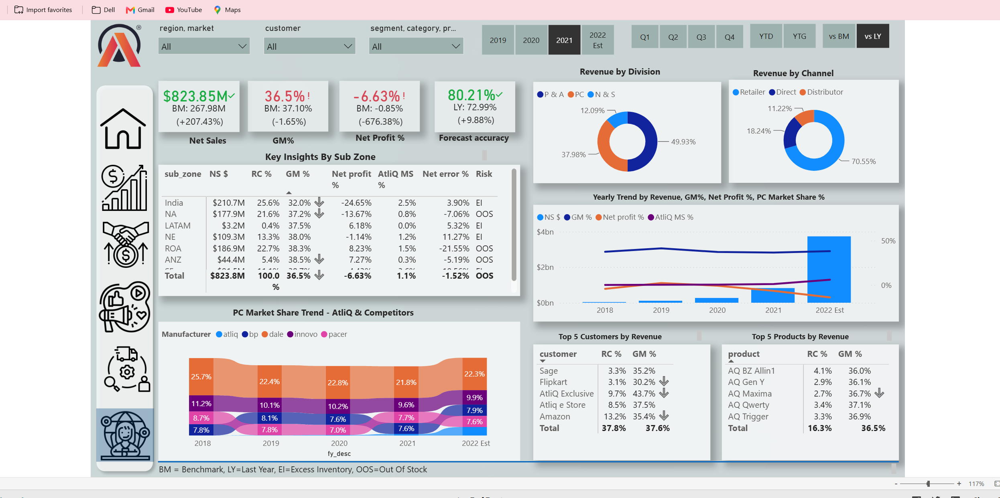
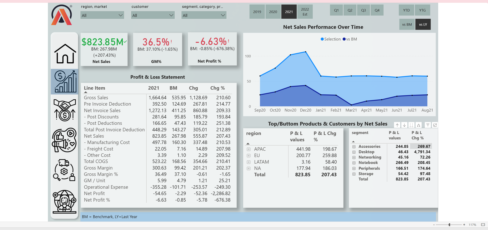
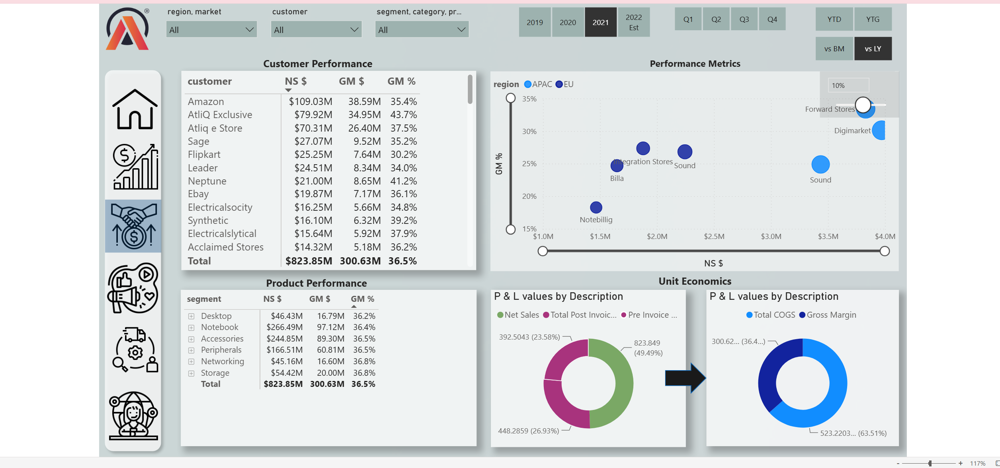
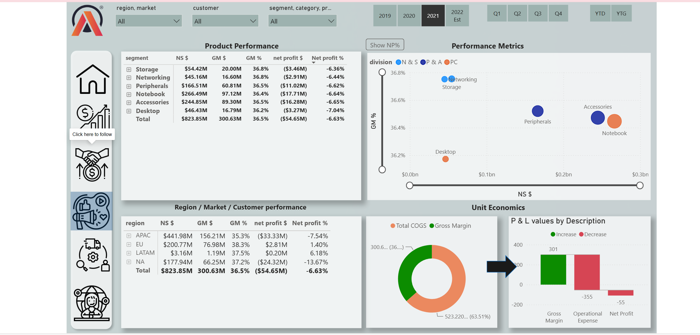
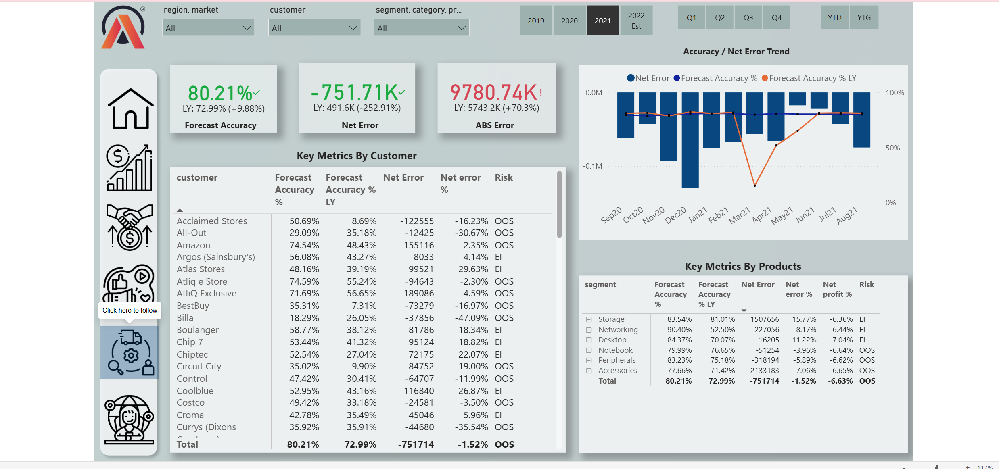

# AtliQ Business Insights 360 | Power BI Business Intelligence Project

### Transforming Business Data into Actionable Insights

An interactive Business Intelligence solution developed using **Microsoft Power BI** to analyse business performance across Finance, Sales, Marketing, Supply Chain and Executive functions.

The project brings multiple business perspectives into one consolidated reporting solution, helping decision-makers monitor KPIs, evaluate performance and identify areas requiring attention.

---

## 🚀 Project Dashboard

**[🔗 Explore the Interactive Power BI Dashboard](https://app.powerbi.com/view?r=eyJrIjoiMTY3NzY4NDItMmFhYi00MzZlLTkwNjYtMGNkOGY4ZjBkOTlhIiwidCI6ImM2ZTU0OWIzLTVmNDUtNDAzMi1hYWU5LWQ0MjQ0ZGM1YjJjNCJ9)**

**[📄 View Project Presentation (PDF)](./AtliQ_Business_Insights_360.pdf)**

---

## 📊 Project Overview

The objective was to build an interactive reporting solution that provides visibility into key business metrics and supports performance analysis across different business functions.

The dashboard consists of five analytical views:

### 1. Executive Analytics

A consolidated overview of organisational performance.

* Net Sales and Gross Margin %
* Net Profit %
* Forecast Accuracy
* Revenue contribution by division and channel
* Market share trends
* Top customers and products

### 2. Finance Analytics

Evaluates financial performance and profitability.

* Profit & Loss analysis
* Gross Sales and Net Sales
* Cost of Goods Sold (COGS)
* Gross Margin and Net Profit
* Performance comparison against benchmarks

### 3. Sales Analytics

Examines customer and product performance.

* Customer-level sales performance
* Product and segment analysis
* Gross Margin contribution
* Regional and market performance
* Customer profitability metrics

### 4. Marketing Analytics

Evaluates product, market and profitability performance.

* Product segment analysis
* Regional performance comparison
* Gross Margin %
* Net Profit %
* Unit Economics

### 5. Supply Chain Analytics

Monitors forecast quality and operational risks.

* Forecast Accuracy %
* Net Error
* Absolute Error
* Customer-level forecast performance
* Product-level forecast performance
* Excess Inventory and Out-of-Stock risk indicators

---

## 🛠️ Tools & Technologies

| Tool               | Application                            |
| ------------------ | -------------------------------------- |
| Microsoft Power BI | Interactive dashboards and reporting   |
| Power Query        | Data cleaning and transformation       |
| DAX                | Calculated measures and business KPIs  |
| Data Modelling     | Relationships and analytical structure |
| Data Visualization | Business performance reporting         |

---

## 💡 Business Questions Addressed

* How is the business performing financially?
* Which customers and products contribute most to revenue?
* Which markets and product segments perform better?
* How does revenue translate into gross margin and net profit?
* How accurate are demand forecasts?
* Which customers or products show potential inventory risks?

---

## 📈 Key Learning Outcomes

Through this project, I strengthened my practical understanding of:

* Building interactive Power BI reports.
* Transforming and preparing data using Power Query.
* Developing business measures using DAX.
* Creating data models and relationships.
* Selecting KPIs based on business requirements.
* Communicating analytical findings through dashboards.

---

## 📁 Project Resources

* Interactive Power BI Dashboard
* Project Presentation (PDF)
* Executive Dashboard Screenshot
* Finance Dashboard Screenshot
* Sales Dashboard Screenshot
* Marketing Dashboard Screenshot
* Supply Chain Dashboard Screenshot
* - 📑 [Download PowerPoint Presentation](./AtliQ_Business_Insights_360.pptx)

---

## 👨‍💻 Author

**Arpan Das**
Aspiring Data Analyst | SQL | Power BI | Excel | Python

* GitHub: [arpan-data](https://github.com/arpan-data)
* LinkedIn: [Arpan Das](https://www.linkedin.com/in/arpan-das-785799379)

---

*This is a portfolio project developed for learning and demonstrating practical Business Intelligence and Data Analytics skills.*
